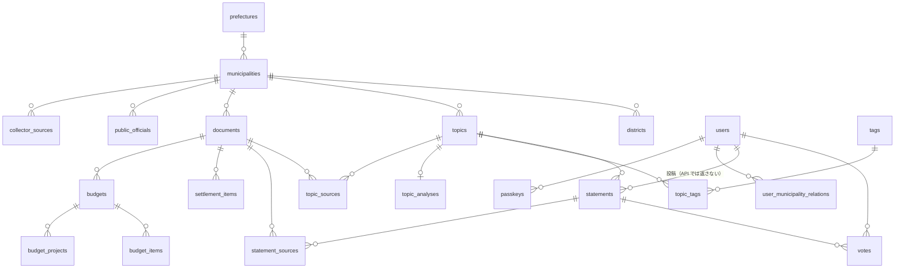

# DB のテーブル

今の DB の形です。正は `backend/migrations/`（このファイルは2026-10-29、マイグレーション17本の時点）。
テーブルを足したり変えたりしたら、ここと [operations/data-flow.md の「テーブルの一覧（誰が書くか）」](../operations/data-flow.md#テーブルの一覧誰が書くか) を直す。

## 共通の決まり
- SQLite と PostgreSQL の両方で動く SQL で書く（SQLite 固有の関数を避ける）。開発は SQLite、将来 PostgreSQL へ移す
- ID は TEXT。UUID v7（`shared::util::new_id`）。行政区分は公的なコード（自治体は総務省の全国地方公共団体コード6桁）
- 日時は ISO8601 の文字列（UTC、ミリ秒まで。`shared::util::now_iso`）。文字列のまま比べて期限などを決めるので、形をそろえる
- 金額は千円の整数、比率は1000倍の整数（浮動小数点の誤差を避ける）
- 状態の値は DB の CHECK と `backend/src/shared/status.rs` の型が同じ（`tests/schema.rs` で確かめる）
- 自治体に属するデータは `municipality_id` を持ち、API・クエリは必ずそれで絞る
- main にマージしたマイグレーションは書き換えない。変更は新しいマイグレーションで

## 関係の全体

## 行政区分
| テーブル | 中身 |
|---|---|
| `prefectures` | 都道府県（`code` 2桁） |
| `municipalities` | 市区町村（`id` 6桁、URL の `slug`、`is_active`: 公開中か。準備中は運営者の API だけが扱う） |
| `districts` | 地区（`id` は `<団体コード>-<ローマ字>`）。トピックの地区タグにだけ使う |
| `municipality_stats` | 年度ごとの人口・世帯（決算カードから） |

## 参加者（ADR 0002・0006）
| テーブル | 中身 |
|---|---|
| `users` | 参加者。`registered_at`（パスキーを登録した＝投稿できる）、`is_operator`（運営者）。名前・メール・年齢・性別は持たない。`home_municipality_id` は使っていない |
| `user_municipality_relations` | 自治体ごとの関わり方 `residency_type`（resident / neighbor / commuter / related）。`district_id` は集めない（ADR 0002。列は古い名残で、常に NULL） |
| `passkeys` | パスキー（webauthn-rs の JSON。公開鍵と ID） |
| `webauthn_challenges` | 登録・ログインの途中の状態（1回だけ使える。5分） |
| `operator_invites` | 運営者の招待（トークンのハッシュだけ。24時間・1回だけ） |

## トピックと意見（Polis のコア）
| テーブル | 中身 |
|---|---|
| `topics` | 議論の場。`status`: draft（運営者の確認待ち。API のどこにも出さない）/ published / archived。`source_type`: assembly / citizen。`published_at`・`closes_at`（投票の期限。過ぎたら締め切り。NULL は期限なし。ADR 0005）。`tagged_at`（自動のタグ付けが済んだ） |
| `statements` | 意見（1〜140文字）。`status`: pending（判定待ち）/ approved / rejected / flagged（人が確かめる）。`user_id` は投稿者（NULL は議会の主張・運営者の意見。API では返さない）。`is_seed`: 最初の意見（分析を開く条件に使う）。`moderation_note`: 判定の理由 |
| `votes` | 票（1 / -1 / 0）。`(user_id, statement_id)` に UNIQUE。あとから変えられない |
| `topic_analyses` | トピックごとの分析の結果（Polis の数理。`docs/polis-math.md`）。`result` は公開してよい形、`state` は次の計算への引き継ぎ |

## タグ
| テーブル | 中身 |
|---|---|
| `tags` | `kind`: field（分野。共通の語彙は seed。`description` が定義）/ district（地区。`id` は `district-<地区 ID>`。初めて付けるときに作る） |
| `topic_tags` | トピックのタグ。`assigned_by`: ai / admin |
| `settlement_item_tags` | 決算・予算の費目と分野タグの対応（おおまか。seed） |

## 資料と出典（ADR 0004、`design/collection.md`）
| テーブル | 中身 |
|---|---|
| `collector_sources` | 収集先（`kind`: minutes / settlement_card / budget、アダプタと設定の JSON。規約の確認日は設定の中） |
| `fetch_cache` | 条件付き取得の記録（ETag・更新日時・ハッシュ） |
| `documents` | 取り込んだ資料の出典（URL・開催日・ハッシュ・`extraction`: api / manual）。原本は持たない |
| `public_officials` | 公人（首長・議員）の名簿と任期。会議録の発言者を機械的に対応付ける |
| `topic_sources` | トピックの出典（会議録の発言からの引用。原文と一致する200字以内。発言者は公人なら氏名、職員は職名だけ） |
| `statement_sources` | 最初の意見の根拠の発言（運営者の確認用。API では返さない） |

## まちのお金
| テーブル | 中身 |
|---|---|
| `settlement_items` | 決算カードの数字（`category`: revenue / expenditure_purpose / expenditure_nature / indicator、`item_key` は原表の費目名、`unit`: thousand_yen / milli）。下書きを持たない |
| `budgets` | 当初予算（`status`: draft / published / archived、歳出の合計） |
| `budget_items` | 予算の款別・性質別・歳入 |
| `budget_projects` | 主な事業（名前・金額・新規/拡充の印・PDF のページ）。説明の文章は持たない（市の著作物のため） |
| `budget_project_tags` | 事業の分野タグ |

## 運用
| テーブル | 中身 |
|---|---|
| `llm_usage` | AI の呼び出しごとの使用量と推定の費用（`purpose`: moderation / tagging / eval / extraction）。1日の上限の判定に使う |
