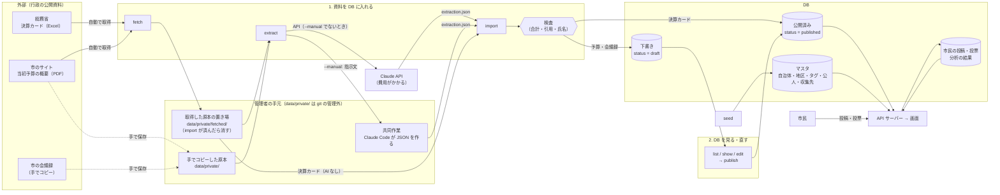
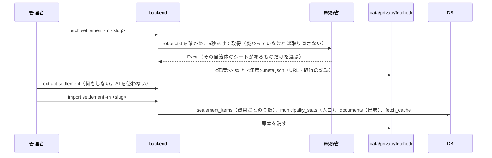
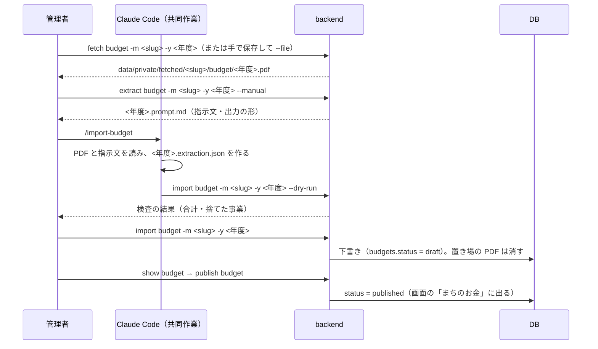
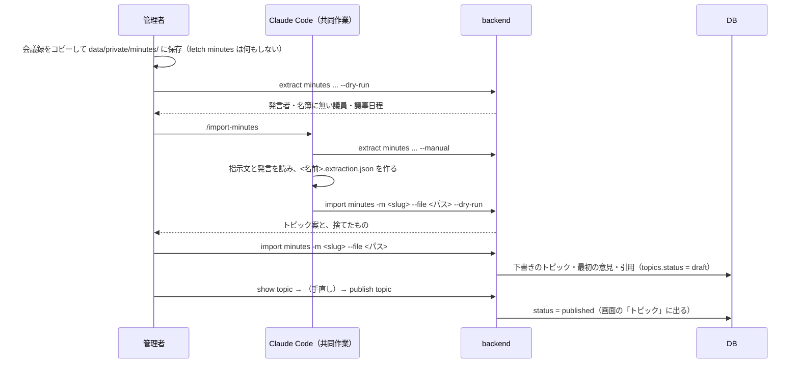
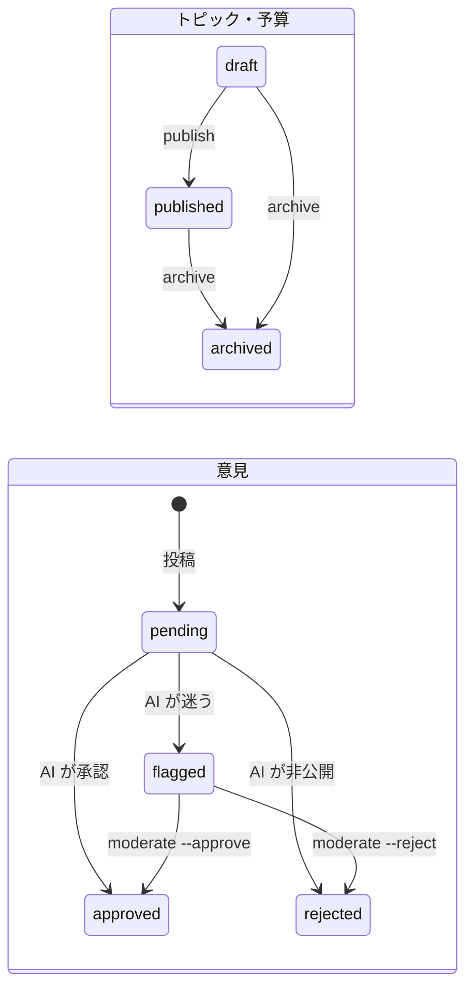

# データの流れ（サーバー管理者向け）

資料（決算カード・予算の概要・会議録）がどこから来て、どのコマンドで、DB のどこに入り、画面に出るまでを1枚にまとめたものです。
コマンドの使い方の詳細は [operations/cli.md](cli.md)、収集の方針は [design/collection.md](../design/collection.md) にあります。

## 全体の図

**ポイント**
- **コマンドは `<動詞> <対象>` の形で、段階ごとに分かれています**（[operations/cli.md](cli.md)）。資料は3種類とも `fetch` → `extract` → `import` の同じ流れを通り、その資料に要らない処理（決算カードの `extract`、会議録の `fetch`）は何もせずに通ります
- **下書き（draft）は API のどこにも出ません。** 画面に出るのは、運営者が `publish` したものだけです（決算カードは AI を使わない決まった形の表なので、取り込んだらそのまま公開されます）
- **AI を呼ぶのは `extract` だけです。** Claude API（費用がかかる）か、管理者と Claude Code の共同作業（`--manual`。費用なし）。どちらの出力も `import` で同じ検査を通ります
- **原本は DB に入れません。** DB には数字・事業の名前・短い引用・出典（URL・ハッシュ）だけが入ります。`fetch` で取った原本は `import` が済んだら消えます

## データの置き場所

| 場所 | 中身 | git | 本番では |
|---|---|---|---|
| リポジトリ（`backend/` `frontend/` `data/seeds/` `docs/`） | コード、マスタの seed、ドキュメント | 管理する（公開） | 同じものを動かす（AGPL） |
| `data/private/` | 会議録・PDF の原本、共同作業の prompt と JSON。`fetched/` は `fetch` で取った原本（`import` が済んだら消える） | **管理しない** | 取り込みの作業のときだけ置く |
| `data/dev-seeds/` | 【サンプル】の架空のデータ | 管理する | **入れない** |
| DB（開発は `data/civic.db`） | すべてのデータ | 管理しない | バックアップする（フェーズ7） |
| `.env` | API キー、署名の鍵、連絡先 | **管理しない** | サーバーにだけ置く |

## 資料ごとの流れ

ここでは、資料が何を通ってどこに入るかを示します。実際に打つコマンドの手順は [operations/cli.md の「よくある流れ」](cli.md#よくある流れ) にあります。

| | 決算カード | 当初予算の概要 | 会議録 |
|---|---|---|---|
| 取得元 | 総務省（全国共通の Excel） | 市のサイトの PDF | 市の会議録（手でコピー。規約のため自動では取らない） |
| `fetch` | 総務省から自動で取得 | 市のサイトから自動で取得か、手で保存 | 何もしない（手で `data/private/minutes/` に保存） |
| `extract`（AI） | 何もしない（AI を使わない） | API か共同作業（`--manual`） | API か共同作業（`--manual`） |
| `import` | Excel を読んで保存 | JSON を検査して下書きに | JSON を検査して下書きに |
| 検査 | 表の形 | 款別・性質別・歳入の合計、事業の名前と金額がそのページの本文にあるか | 引用が原文どおりか、意見に氏名が無いか、根拠の発言があるか、名簿 |
| 入る先 | `settlement_items` `municipality_stats` `documents` | `budgets` `budget_items` `budget_projects` `budget_project_tags` `documents` | `topics` `statements` `topic_sources` `statement_sources` `documents` |
| 公開の前の確認 | なし（そのまま公開） | `show budget` → `publish budget` | `show topic` → `publish topic`（または管理画面の「下書き」） |
| 頻度 | 年1回 | 年1回（2〜3月） | 定例会のあと（年4回、1回に数日分） |
| 費用 | 0 | API なら約 0.8 ドル、共同作業なら 0 | API なら1日分 0.3〜0.4 ドル、共同作業なら 0 |

### 決算カード

### 当初予算の概要

API で読むときは、`extract budget` を `--manual` なしで実行します（費用がかかる）。そのあとの `import` は同じです。

### 会議録

- 名簿に無い首長・議員がいると止まります。`data/seeds/030_officials_<団体コード>_<slug>.sql` に登録して `seed` してから、やり直します
- 職員の氏名は AI に渡しません（職名だけ）。名前を出すのは選挙で選ばれた公人だけです（ADR 0004）

## マスタ（seed）

`cargo run -- seed` が `data/seeds/*.sql` をファイル名の順に入れます。何度実行しても同じ結果になります。

| ファイル | 入る先 | 変えるとき |
|---|---|---|
| `001_prefectures.sql` | `prefectures` | ほぼ変えない |
| `010_municipality_<団体コード>_<slug>.sql` | `municipalities` `districts` `collector_sources` | 自治体を足すとき |
| `020_field_tags.sql` | `tags`（分野の共通の語彙） | 語彙を見直すとき |
| `025_settlement_item_tags.sql` | `settlement_item_tags`（費目 ↔ 分野） | 対応を見直すとき |
| `030_officials_<団体コード>_<slug>.sql` | `public_officials`（首長・議員と任期・読み） | 選挙のあと |

## サーバーの中で自動で動くもの

API サーバー（引数なしで起動）は、次の処理をバックグラウンドで続けます。

| 処理 | 間隔 | 読む | 書く | API キー |
|---|---|---|---|---|
| 分析（Polis の意見マップ・グループ・合意点） | `ANALYSIS_INTERVAL_SECS`（既定10秒）。投票が変わったトピックだけ | `votes` `statements` | `topic_analyses` | 不要 |
| 投稿のモデレーションのやり直し | 60秒 | `statements`（pending） | `statements.status` | 要る |
| トピックの自動のタグ付け | 60秒 | タグの無いトピック | `topic_tags` | 要る |

- 市民の投稿は、届いたその場で AI が判定します（承認・非公開・人が確かめる）。判定できなかった（通信の失敗・費用の上限）ものは pending のまま残り、上の処理でやり直します
- 人が確かめる（flagged）ものは、管理画面（`/operator`）の「確認待ち」か、`list statement` → `moderate statement --id <id> --approve` / `--reject`
- AI の使用量と推定の費用は `llm_usage` に記録され、1日の上限（`LLM_DAILY_BUDGET_USD`・`LLM_EXTRACTION_DAILY_BUDGET_USD`）を超えると呼びません

## 状態の移り変わり

画面に出るのは、`published` のトピック・予算と、`approved` の意見だけです。

## テーブルの一覧（誰が書くか）

| まとまり | テーブル | 書くもの |
|---|---|---|
| 行政区分のマスタ | `prefectures` `municipalities` `districts` | seed |
| | `municipality_stats`（人口） | `import settlement` |
| タグ | `tags` `settlement_item_tags` | seed |
| | `topic_tags` | `import minutes`・`classify topic`（自動のタグ付け）・`add tag` |
| 公人 | `public_officials` | seed |
| 収集 | `collector_sources` | seed |
| | `fetch_cache`（条件付き取得の記録） | `import`（保存が済んだあと）・`fetch`（その自治体のシートが無い Excel） |
| 資料の出典 | `documents`（URL・ハッシュ・作り方 `extraction`。原本は持たない） | `import` |
| 決算 | `settlement_items` | `import settlement` |
| 予算 | `budgets` `budget_items` `budget_projects` `budget_project_tags` | `import budget`・`publish budget` |
| トピック | `topics`（公開の日時 `published_at`・投票の期限 `closes_at`・市民の提案をした人 `proposed_by`・公開待ち `queued_at`）`topic_sources`（引用） | `import minutes`・`edit topic`・`publish topic` など・管理画面・市民の提案（`POST /proposals`）・自動公開 |
| | `topic_parents`（市民のまとめから提案したトピックの元のトピック） | 市民の提案（`POST /proposals` の `parent_ids`） |
| 自動公開 | `publish_slots`（公開の時刻） | `add slot` など・管理画面 |
| 意見 | `statements` | `import minutes`（最初の意見）・市民の投稿 |
| | `statement_sources`（最初の意見の根拠の発言。API では返さない） | `import minutes` |
| 参加者 | `users` `user_municipality_relations`（関わり方） | 市民（API） |
| | `votes` | 市民（API） |
| 分析 | `topic_analyses` | 分析の処理 |
| AI | `llm_usage`（使用量・推定の費用） | AI を呼ぶすべての処理 |

投稿者が誰かは、API の応答に一切含めません（匿名性）。

## 1年の作業の目安

| 時期 | 作業 |
|---|---|
| 2〜3月 | 当初予算の概要が出たら、予算を取り込む（`/import-budget`）→ `publish budget` |
| 定例会（3・6・9・12月）の会議録が公開されたら | 1日分ずつ取り込む（`/import-minutes`）→ 管理画面（`/operator`）の「下書き」で確かめて公開 |
| 決算カードの公表のあと | `fetch settlement -m <slug>` → `import settlement -m <slug>` |
| 選挙のあと | `data/seeds/030_officials_*.sql` を直して `seed` |
| いつでも | 管理画面の「確認待ち」（人が確かめる意見）、「公開中」（期限の近いトピック）。`list source`（規約の確認から1年を過ぎると警告） |

## 困ったとき

| こんなとき | すること |
|---|---|
| 公開したトピック・予算を引っ込めたい | `archive topic --id <id>` / `archive budget -m <slug> -y <年度>`（画面から消える。データは残る） |
| 取り込みをやり直したい | `import minutes … --again` / `import budget … --again`（予算は下書きに戻る。置き場の PDF が消えていたら、もう一度 `fetch` するか `--file`） |
| 最初の意見を直したい | `edit statement --id …` / `remove statement --id …`（投票がある意見は直せない） |
| 分析がすぐに見たい | `analyze topic --id <id> --force` |
| AI の費用を確かめたい | DB の `llm_usage`（`cost_micro_usd` は100万分の1ドル） |
| コマンドの使い方を忘れた | `cargo run -- --help`、`cargo run -- <コマンド> --help` |
